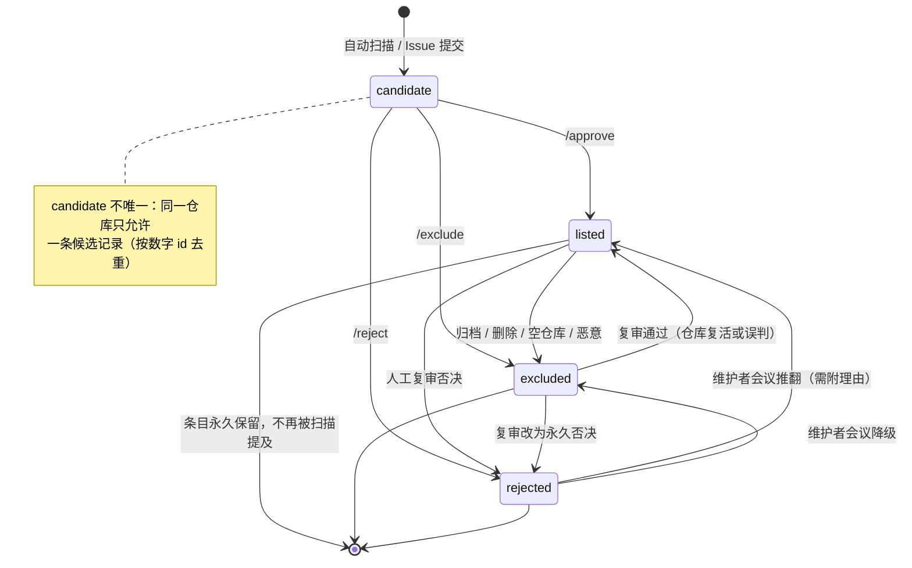

# 治理规则（GOVERNANCE）

本项目核心机制不是“人工编辑清单”，而是**一套带记忆的名单制度**：自动化不断发现，人工只做一次性裁决，裁决结果永久留存。本文档定义这套制度的全部规则，以及它如何被维护者、被审计、被推翻。

## 目录

- [1. 设计原则](#1-设计原则)
- [2. 四种状态与流转](#2-四种状态与流转)
- [3. 谁能批准、谁能否决](#3-谁能批准谁能否决)
- [4. 裁决的效力与复审机制](#4-裁决的效力与复审机制)
- [5. 评分、阈值与抓取策略](#5-评分阈值与抓取策略)
- [6. 数据变更与审计](#6-数据变更与审计)
- [7. 维护者角色](#7-维护者角色)
- [8. 角色分配与退出](#8-角色分配与退出)
- [9. 争议解决顺序](#9-争议解决顺序)
- [10. 规则自身的修改](#10-规则自身的修改)

---

## 1. 设计原则

四条原则，决定了后面所有规则为什么长这样：

1. **主键稳定。** 主键是 GitHub 仓库**数字 id**，`full_name` 只作展示。仓库改名、转移组织都不产生新条目；旧名进 `aliases`。这使“同一仓库不会被重复讨论”。
2. **一次裁决，终身记忆。** 仓库一旦进入 `listed` / `excluded` / `rejected`，自动化**永不再提**。目的是终止无限循环：爬虫每轮都会重新发现同一个仓库，若不记住“已判定”，Issue 区会被同一批仓库反复淹没。
3. **只对新面孔开口。** 自动化只对**从未出现过**的仓库建 Issue，且有数量上限。人的注意力是稀缺资源，制度必须保护它。
4. **一切可审计。** 状态变更写入数据文件（git 历史可查）**并**追加到 `data/state/changelog.jsonl`（事件流可查）。两种记录互相对照，防止静默改写。

## 2. 四种状态与流转

### 2.1 状态定义

| 状态 | 含义 | 是否出现在 README | 存储文件 | 自动化是否再提 |
| --- | --- | --- | --- | --- |
| `candidate` | 候选，等待人工裁决 | 否 | `data/candidates/queue.json` | 否（同一轮内） |
| `listed` | 已收录 | 是 | `data/entries/listed.json` | **否，永不** |
| `excluded` | 技术性排除：archived、空仓库、fork、无相关内容信号 | 否 | `data/entries/excluded.json` | **否，永不** |
| `rejected` | 人工否决，永久 | 否 | `data/entries/rejected.json` | **否，永不** |

`excluded` 与 `rejected` 的区别很关键：

- `excluded` 是**技术性判断**，依据是仓库的客观状态（归档了、空的、是 fork、找不到相关内容）。仓库状态改变（解除归档、补了内容、加了 README）后，技术上就有翻案空间。
- `rejected` 是**人工意志**，依据是人对相关性的判断或对贡献者的判断。翻案成本更高，需要正式复审。

### 2.2 状态流转图



### 2.3 流转约束（硬规则）

| 约束 | 说明 |
| --- | --- |
| 同一 `id` 只能出现在一个状态文件中 | 由 `node scripts/validate.mjs` 强制检查（`duplicate id`） |
| `candidate` -> 终态必须通过 Issue 命令或脚本 | 不允许直接手改 JSON 跳过裁决（PR 中手改候选队列会被拒） |
| 终态之间迁移必须留痕 | 每次迁移追加 `changelog.jsonl` 一行，含 `from`/`to`/`reason`/`actor` |
| 迁移到 `listed` 必须带 `evidence` | 无证据的收录在 validate 阶段失败 |
| `rejected` 必须带理由 | 空理由的 `/reject` 不执行 |
| 自动化不得把终态仓库重新压回 `candidate` | 由扫描器的“已见集合”保证 |

## 3. 谁能批准、谁能否决

### 3.1 权限判定

裁决命令只在**该候选仓库对应的 Issue 中**、由**对本仓库（awesome-luotianyi）拥有 `write` 或 `admin` 权限的用户**发表时才会被执行。

注意这里有两个容易混淆的“仓库”：

| 仓库 | 是否需要权限 | 说明 |
| --- | --- | --- |
| `owner/repo`（被提名的第三方仓库） | **否** | 提名者不需要是它的作者或维护者 |
| `luotianyi-community/awesome-luotianyi`（本索引仓库） | **是** | 评论者必须是本仓库的 write/admin |

因此：条目作者可以在 Issue 里提供证据、纠正误解，但**不能自己** `/approve` 自己的仓库。这是刻意的，防止自我收录。

### 3.2 自动化校验顺序

1. 评论是否以命令前缀开头（`/approve`、`/reject`、`/exclude`）；
2. 评论者在本仓库的 `author_association` 是否为 `OWNER` / `MEMBER` / `COLLABORATOR`（或经 API 核实有 write/admin）；
3. 参数是否合法（`/approve` 的分类 id 必须在 9 类内；`/reject`、`/exclude` 必须带非空理由）；
4. 该仓库 `id` 是否仍处于 `candidate`；已在终态的，命令被忽略并回复说明（提示走复审）。

任一环节不满足，命令**静默无效**并留下一条说明性回复。不要指望“多发几次就会生效”。

### 3.3 命令对照

| 命令 | 目标状态 | 参数要求 | 典型理由写法 |
| --- | --- | --- | --- |
| `/approve <category-id>` | `listed` | 9 类之一，原样小写 | `/approve desktop-pet` |
| `/reject <reason>` | `rejected` | 理由非空 | `/reject 通用绘图库，任何地方都未提及洛天依` |
| `/exclude <reason>` | `excluded` | 理由非空 | `/exclude 仓库已 archived（2025-06）` |

维护者脚本等价入口（用于批量处理或 Issue 不可用时）：

```bash
node scripts/add-entry.mjs add <owner/repo> --category <id> [--desc "..."]
node scripts/add-entry.mjs reject <owner/repo> --reason "..."
node scripts/add-entry.mjs exclude <owner/repo> --reason "..."
```

脚本与 Issue 命令写入同一数据文件、同一审计流，效力相同；差别只是脚本需要本地执行并有推送权限，因此天然受 PR 审查约束。

## 4. 裁决的效力与复审机制

### 4.1 效力

- **`listed`**：条目出现在 README，直到仓库状态变化（归档/删除/被判恶意）或人工复审将其移出。
- **`excluded`**：条目不出现在 README，自动化不再为该仓库建 Issue。理由保留在 `excluded.json`，任何人可查。
- **`rejected`**：同上，且额外含义是“这个相关性判断已经被人工明确否定过”。**否决是永久但不绝对**——见 4.3。

### 4.2 为什么“永不再提”是硬规则

因为扫描器每轮都会重新命中同一批仓库（尤其是名字含 `luotianyi` 但内容无关的仓库）。如果每次都建 Issue：

- 维护者要重复裁决同一件事；
- 新候选被噪音淹没；
- 提名者会误以为“上次没处理”，反复催办。

因此“已见集合”包含 `listed` / `excluded` / `rejected` 三种终态的全部数字 id。**说“永不再提”是字面意思**：不是“一段时间内不提”，也不是“人工可以催出来”。

### 4.3 复审：否决是永久但不绝对

`rejected` 的“永久”指“不会被自动化或普通流程自动翻案”，不指“维护者永远不能改”。复审路径：

| 触发条件 | 谁可以发起 | 需要的材料 | 决策方式 |
| --- | --- | --- | --- |
| 仓库实质变化（补了洛天依相关内容、README 重写、从通用工具转为专题项目） | 任何人 | 变化前后对比 + 当前证据 | 单一 Reviewer 可改判为 `candidate` 再走正常裁决 |
| 原裁决事实错误（例如证据被误读、仓库被误认） | 任何人 | 指出错误的具体所在 | 单一 Reviewer 可改判 |
| 规则变更导致原判断不再符合新标准 | 维护者 | 说明哪条规则变了 | 单一 Reviewer 可改判 |
| 权利人下架请求 | 权利人 / 任何人转达 | 通知原文 | **无需讨论，直接移出** |
| 对裁决本身有异议但无新事实 | 任何人 | 说明理由 | 需**维护者会议**（≥2 名维护者，Lead 参与）表决 |

维护者会议的推翻要求：

1. 在 Issue 或 Discussion 中提出，标题含 `[review]`；
2. 至少 2 名维护者参与，其中至少 1 名是 Lead；
3. 结论写入 `changelog.jsonl`，含 `action: "overturn"`、原理由、新理由、参与人；
4. 被推翻的 `rejected` 条目迁移到 `listed` 或 `excluded`，**不删除**原否决记录（保留在 changelog）。

**不构成复审理由的**：

- “这是我朋友的仓库”（利益相关，应回避）；
- “多收录一个也没什么坏处”（收录标准是窄的，宽一点就不是索引了）；
- 反复开 Issue 催办（会按 [CODE_OF_CONDUCT.md](./CODE_OF_CONDUCT.md) 第 2 节的灌水条款处理）。

## 5. 评分、阈值与抓取策略

### 5.1 每轮做什么

自动化每一轮依次处理三类信号：

1. **疑似相关的新仓库**：按关键词（洛天依 / Luo Tianyi / 天依 / Vsinger / 中文V家）搜索 GitHub，得到候选集合；
2. **近期提交**：已收录仓库与候选仓库的近期 push，用于刷新 `pushed_at`、发现活跃度变化；
3. **近期 Issue / PR**：社区在相关仓库中的讨论，作为相关性佐证或失效信号。

### 5.2 评分与阈值

每个信号被打分，超过阈值才进入下一步。评分维度（按权重从高到低）：

| 维度 | 说明 | 权重 |
| --- | --- | --- |
| 主题命中强度 | `full_name` / About 描述 / README 首屏出现主题词的位置与次数（标题 > 描述 > 正文） | 高 |
| 内容实质 | 是否有与该主题直接相关的文件或资源（模型文件、音源引用、角色配置） | 高 |
| 活跃度 | 最近 12 个月是否有提交 | 中 |
| 项目完整度 | 有 README、有 LICENSE | 中 |
| 社区认可度 | star 数（≥3 视为有效信号） | 低 |
| 噪音惩罚 | 名字碰撞、仅 URL 命中、纯个人主页、空仓库、fork | **负向，压到阈值以下** |

阈值不是精确分数，而是“必须满足项全部通过 + 总分超过一条内部线”。必须满足项见 [CRITERIA.md](./CRITERIA.md)。评分只在**决定是否建 Issue** 时使用，最终收录仍由人工裁决——**评分高不等于收录**。

### 5.3 每轮上限与限流

| 参数 | 取值 | 原因 |
| --- | --- | --- |
| 每轮最多新建 Issue | **20** | 保护人的注意力，也避免触发 GitHub 的滥用检测 |
| Issue 标题前缀 | `[candidate] owner/repo` | 便于搜索、过滤、去重 |
| 同一仓库同时存在的候选 Issue | 1 | 按数字 id 去重，已存在则不新建 |
| API 认证方式 | 工作流内置 `GITHUB_TOKEN` | 认证后 5000 次/小时，远高于未认证的 60 次/小时 |
| 请求节奏 | 串行 + 固定间隔，遇 `403`/`429` 按 `X-RateLimit-Reset` 等待 | 不做并发爆发，避免次级限流 |
| 分页 | 每类查询按需翻页，设上限，不无限翻 | 控制单轮耗时与配额消耗 |

上表参数以仓库内的自动化配置为准（当前为 `data/rules/detection.json` 中的 `caps` 与 `thresholds`）。文档与配置不一致时，以配置为实际执行值，并应提 PR 修正文档——不要让文档描述与脚本行为长期脱节。

超过 20 个的候选**不会丢失**：留在扫描结果里，下一轮继续处理（优先级按分数排序）。因此“本轮没建 Issue”不等于“被丢弃”。此外还有单 owner 限额（当前配置为 4），防止某个组织的一次提交淹没候选队列。

### 5.4 抓取失败的处理

- 单仓库抓取失败（404/5xx）：本轮跳过，不写任何状态；不因一次失败就标 `excluded`。
- 连续多轮 404：才标记 `excluded`，理由 `deleted or private`。
- 整轮失败：不产生部分写入；下一轮重跑，靠“已见集合”天然幂等。

## 6. 数据变更与审计

### 6.1 两套记录

| 记录 | 位置 | 特点 | 用途 |
| --- | --- | --- | --- |
| 状态快照 | `data/entries/*.json`、`data/candidates/queue.json` | 当前事实，可被覆盖为最新值 | 回答“现在是什么状态” |
| 事件流 | `data/state/changelog.jsonl` | **只追加**，一行一条 JSON，从不重写 | 回答“什么时候、被谁、为什么改的” |

两者必须一致：`validate.mjs` 会检查每个状态文件的条目是否都有对应的最近一次变更记录。

### 6.2 changelog 行格式

```json
{"ts":"2026-11-08T10:31:00Z","repo_id":458221975,"full_name":"example-org/luotianyi-live2d-kit","from":"candidate","to":"listed","category":"live2d","reason":"README 与 assets 均含洛天依 Live2D 模型","actor":"maintainer:alice","action":"approve","issue":42}
```

| 字段 | 必填 | 含义 |
| --- | --- | --- |
| `ts` | 是 | ISO 8601 UTC 时间 |
| `repo_id` | 是 | 仓库数字 id，主键 |
| `full_name` | 是 | 变更时的展示名 |
| `from` / `to` | 是 | 状态迁移，新候选的 `from` 为 `new` |
| `reason` | 是 | 理由，与命令中给出的理由一致 |
| `actor` | 是 | 执行者，`maintainer:<name>` / `auto-scan` / `issue-command` |
| `action` | 是 | `approve` / `reject` / `exclude` / `refresh` / `overturn` / `rights-takedown` |
| `issue` | 否 | 关联 Issue 号，便于回溯讨论 |

规则：**禁止改写已存在的 changelog 行**。发现写错时，追加一行 `action: "correct"` 的更正记录，说明错在哪。

### 6.3 审计方式

任何人都可以核对一次变更：

```bash
# 1) 看数据文件的这次改动
git log -p -- data/entries/listed.json | head -60

# 2) 看事件流里对应那条
grep 458221975 data/state/changelog.jsonl

# 3) 两者对不上 = 有问题，开 Issue 报告
```

能审计到什么程度：**“谁改了什么”是可查的，“为什么改”取决于理由质量**。因此我们要求理由写事实（`archived 2025-06`），不写情绪（`不行`）。

## 7. 维护者角色

### 7.1 三种角色

| 角色 | 职责 | 权限 |
| --- | --- | --- |
| **Lead**（1–2 人） | 定义与解释规则；主持复审会议；处理安全与下架请求；对外代表项目 | 本仓库 admin；可合并任意 PR；可推翻 `rejected` |
| **Reviewer**（若干） | 裁决候选（`/approve` 等）；复核 PR；维护 `data/` 准确性；处理条目修正 Issue | 本仓库 write；可执行裁决命令；可合并数据类 PR |
| **Contributor**（所有人） | 提名条目、报告问题、提交 PR、参与讨论 | Fork + PR；评论但**不能**执行裁决命令 |

补充说明：

- **裁决权在 Reviewer 及以上**。Contributor 提供证据与意见，但不能自己拍板收录。
- **分类体系（`data/taxonomy/categories.json`）与本组规则的修改需要 Lead 批准**；Reviewer 可提 PR，不可自合。
- **安全事件与权利人下架请求**由 Lead 统一处理，避免多个渠道给出不一致的答复。

### 7.2 工作量预期（实话）

| 角色 | 每周大致投入 | 主要内容 |
| --- | --- | --- |
| Lead | 1–3 小时 | 复审请求、规则维护、安全响应 |
| Reviewer | 0.5–2 小时 | 处理候选 Issue、复核数据 PR |
| Contributor | 按需 | 一次提名 5 分钟 |

项目没有 SLO 承诺：候选 Issue 可能几天才被处理。急事请 @ 维护者，不要连发三条。

## 8. 角色分配与退出

### 8.1 成为 Reviewer

不设正式申请流程。经验证据：

1. 至少 5 次被合并的数据类贡献，或 10 次提供了被采纳的候选证据；
2. 在候选 Issue 中表现出准确的相关性判断（既有收录也有否决，说明判断有边界）；
3. 同意遵守 [CODE_OF_CONDUCT.md](./CODE_OF_CONDUCT.md) 与本文档；
4. 由现任 Lead 提名，公开在 Discussion 说明理由，无异议即生效。

### 8.2 退出与移除

| 情形 | 处理 |
| --- | --- |
| 主动退出 | 随时可退出，`GOVERNANCE.md` 的角色表更新即可，历史贡献保留 |
| 长期不活跃（>6 个月无任何裁决/合并/评论） | 移至 Emeritus（荣誉维护者），保留只读建议权，不保留裁决权 |
| 违反行为准则 | 按 [CODE_OF_CONDUCT.md](./CODE_OF_CONDUCT.md) 第 6 节的梯度处理，可降级或移除 |
| 滥用裁决权（如为自己的仓库 `/approve`） | 立即撤销 write 权限，相关裁决由 Lead 复审 |

### 8.3 单一维护者时的兜底

若维护者数量降到 1 人（仅 Lead）：

- 仍可正常裁决与合并，但 `rejected` 的**推翻**需在 Discussion 公示 7 天且无人提出异议；
- 若 Lead 长期不可用，任何人可在 Discussion 发起“寻找接任者”，由原 Lead 或社区共识指定。

## 9. 争议解决顺序

遇到分歧，按这个顺序升级，不要跳级：

1. **证据层面**：在候选 Issue 里补充可核验证据（README 原文、文件路径、提交记录）。多数分歧在这一层就消失。
2. **规则层面**：如果分歧源于规则本身模糊，开 `[rules]` Issue 讨论，指出规则哪句话导致了两种解读。
3. **裁决层面**：规则清楚但判断不同，找 Reviewer 复核；复核仍不一致时找 Lead。
4. **复审层面**：涉及已有终态结论的推翻，走 4.3 的维护者会议。
5. **行为层面**：对方行为违反准则，走私密渠道（见 CODE_OF_CONDUCT 第 7 节）。

每一步都要求：先说事实，再说诉求，最后才说情绪。**“我不喜欢这个结论”不是理由，“这个结论与第 X 条标准矛盾”是理由。**

## 10. 规则自身的修改

本文档与 [CRITERIA.md](./CRITERIA.md) 都可以改，但不是随手改：

| 修改类型 | 要求 |
| --- | --- |
| 措辞澄清、补充示例 | 任一 Reviewer 可合 |
| 新增/删除排除项、改阈值、改每轮上限 | PR + Lead 批准 + 在 `changelog.jsonl` 记一条 `action: "rules-change"` |
| 改分类体系（增删类、重命名 id） | 属破坏性变更：需 Lead 批准 + 数据迁移脚本 + 说明对既有条目的影响 |
| 改状态机或“永不再提”硬规则 | 需公开 Discussion 至少 14 天，且需说明如何迁移既有数据 |

**规则变更不溯及既往地自动翻案**：已有终态判定保持原状态，除非按 4.3 单独复审。这样“规则变了”不会变成批量重开 Issue 的借口。

---

相关文档：[收录标准](./CRITERIA.md) · [贡献指南](./CONTRIBUTING.md) · [行为准则](./CODE_OF_CONDUCT.md) · [安全策略](./SECURITY.md) · [商标与二创声明](../NOTICE.md)
